<!-- artwork is generated by scripts/build_assets.py; the header is rebuilt daily onto the output branch -->
<picture>
  <source media="(prefers-color-scheme: dark)" srcset="https://raw.githubusercontent.com/AbhishekBasnet/AbhishekBasnet/output/landscape-dark.svg">
  
</picture>

<picture>
  <source media="(prefers-color-scheme: dark)" srcset="./assets/legend-dark.svg">
  
</picture>

[website ↗](https://abhishekbasnet.github.io) &nbsp;&nbsp;·&nbsp;&nbsp; [linkedin ↗](https://www.linkedin.com/in/abhishekbasnet)
