<picture>
  <source media="(prefers-color-scheme: dark)" srcset="./assets/ridge-dark.svg">
  
</picture>

<picture>
  <source media="(prefers-color-scheme: dark)" srcset="./assets/legend-dark.svg">
  
</picture>

[website](https://abhishekbasnet.github.io) &nbsp;·&nbsp; [linkedin](https://www.linkedin.com/in/abhishekbasnet)
