<picture>
  <source media="(prefers-color-scheme: dark)" srcset="./assets/header-dark.svg">
  
</picture>

 

I build small, focused tools — mostly backends, systems and the quiet parts of software that just need to work.

 

#### 02 — work

[`goredis`](https://github.com/AbhishekBasnet/goredis) &nbsp;·&nbsp; redis, written in go 
[`stampede-guard`](https://github.com/AbhishekBasnet/stampede-guard) &nbsp;·&nbsp; protection against cache stampedes 
[`api-drift`](https://github.com/AbhishekBasnet/Api-Drift) &nbsp;·&nbsp; catching drift between an api and its contract 
[`nixmon`](https://github.com/AbhishekBasnet/NixMon_Unix-Linux-Monitor) &nbsp;·&nbsp; a monitor for unix / linux systems

 

#### 03 — tools

go &nbsp;·&nbsp; python &nbsp;·&nbsp; typescript &nbsp;·&nbsp; linux

 

#### 04 — elsewhere

[website](https://abhishekbasnet.github.io) &nbsp;·&nbsp; [linkedin](https://www.linkedin.com/in/abhishekbasnet)

 

less, but better.
